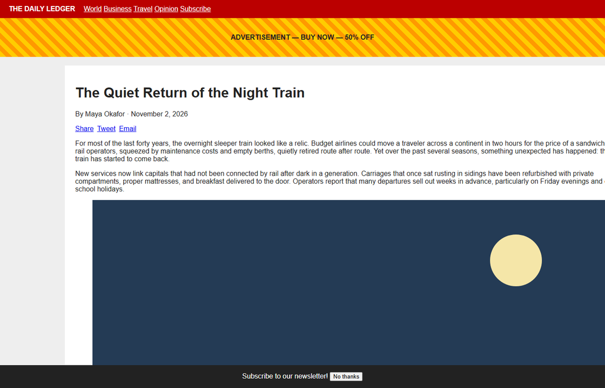
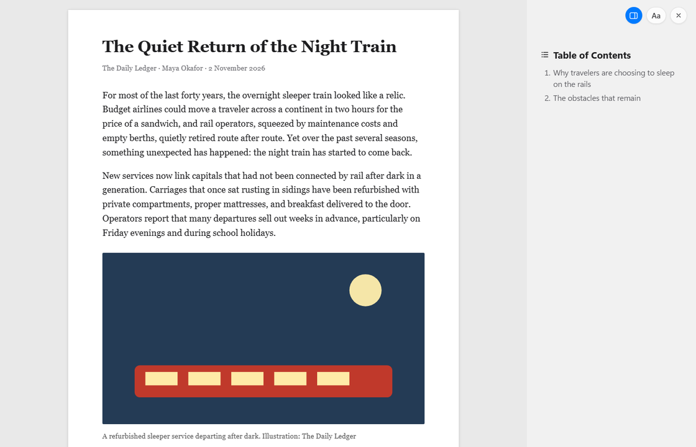
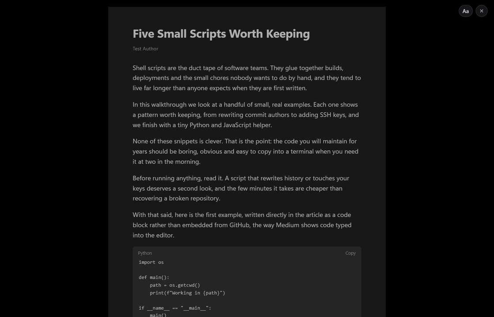

# Reader View

A clean, distraction-free reading mode for Chrome and other Chromium browsers, modelled closely on
Safari Reader. One click turns a cluttered article into just the text, photos, videos and code,
in the font, size and theme you like.

| The page | In Reader |
|---|---|
|  |  |



## Features

- **One click, or Alt+Shift+R.** The toolbar button lights up only on pages that look like
  articles, like Safari's.
- **Make it yours:** four themes (White, Sepia, Gray, Night), eight fonts and zoom from 50% to
  300%. Your choices sync across your browsers.
- **Table of contents** for longer articles, and a **summary** made by Chrome's built-in AI on
  your own computer.
- **Multi-page articles** are joined into one page.
- **Videos and posts stay in:** YouTube, Vimeo, X and Bluesky.
- **Code stays readable:** code blocks and GitHub Gists (including Medium's) get a language
  label and a Copy button.
- **Picks up where you left off:** reopen an article and Reader returns to the paragraph you
  were on.
- **Photos** enlarge with a click. **Print** gives you just the article.
- **Use Reader automatically** on sites you choose.
- **Private:** no accounts, no tracking, no ads. See [Privacy](#privacy).

Reader shows what's on the page. It doesn't unlock paywalled articles.

## Install

Reader View isn't in the Chrome Web Store yet, so you install it from GitHub. It takes about
two minutes and works in Chrome, Edge, Brave, Arc, Dia, Opera and Vivaldi.

1. **Download** `reader-view-v….zip` from the
   [latest release](https://github.com/amokiritu/reader-view/releases/latest).
2. **Unzip it** into a folder you'll keep, for example `Documents\Reader View`. The browser
   runs the extension from this folder, so don't delete it afterwards.
3. **Open your browser's extensions page** by typing its address into the address bar:

   | Browser | Address |
   |---|---|
   | Chrome, Arc, Dia | `chrome://extensions` |
   | Edge | `edge://extensions` |
   | Brave | `brave://extensions` |
   | Opera | `opera://extensions` |
   | Vivaldi | `vivaldi://extensions` |

4. **Turn on Developer mode** (a switch in the top-right corner, or on the left in Edge).
5. Click **Load unpacked** and choose the folder from step 2 (the one that contains
   `manifest.json`).
6. **Pin the button** so it's always visible: click the puzzle-piece icon next to the address
   bar, then the pin next to Reader View.

Open any news article or blog post and click the Reader button.

> Some browsers show a reminder about developer-mode extensions when they start. That's
> expected for extensions installed this way; choose to keep it.

### Updating

Reader View tells you when a new version is out: a small blue arrow appears on its button, and
the **Aa** menu shows a download link. (It checks GitHub once a day.)

To update, download the new zip and unzip it **into the same folder**, replacing the old files.
Then open the extensions page and click the reload arrow on the Reader View card. Your settings
and reading positions are kept.

### Install from source

```bash
git clone https://github.com/amokiritu/reader-view.git
```

Then follow steps 3 to 6 above and choose the `reader-view` folder. Run `git pull` and reload
the extension to update.

## Using Reader

| Action | How |
|---|---|
| Show or hide Reader | Click the toolbar button, or press **Alt+Shift+R** |
| Close Reader | **Esc** (closes the Aa menu or an enlarged photo first) |
| Zoom in, out, reset | **Ctrl/Cmd +**, **Ctrl/Cmd −**, **Ctrl/Cmd 0** |
| Theme, font, zoom | The **Aa** button |
| Always use Reader on a site | **Aa** → "Use Reader automatically on this site" |
| Table of contents and summary | The panel button next to **Aa** |
| Enlarge a photo | Click it; ← and → move between photos |
| Print the article | **Ctrl/Cmd P** while Reader is open |

To change the shortcut, open `chrome://extensions/shortcuts` (or your browser's equivalent).

**Summaries** use Chrome's built-in AI (Gemini Nano), which runs on your computer. The first
time, Reader offers to download the model (a one-time download by Chrome). In other browsers, or
on computers that can't run it, Reader shows the article's key sentences instead, labelled as
such.

**The button stays grey on a page?** Reader only offers itself on pages that look like an
article: home pages, search results and very short pages don't qualify. For local files, turn
on "Allow access to file URLs" on the extension's details page.

## Privacy

Reader View has no servers, accounts, analytics or ads. Everything happens in your browser.

- **Stored on your computer:** reading positions (last 300 articles) and AI summaries.
- **Synced by your browser** (if you use browser sync): theme, font, zoom, panel setting and
  your "use automatically" sites.
- **Network requests Reader makes itself**:
  - while Reader is open: the next pages of a multi-page article (from the same website),
    GitHub Gists the page shows but hadn't loaded yet (from GitHub), and Medium's own embed
    pages for Gists and videos (from the same site);
  - once a day: a check with GitHub for a newer version of Reader View. Nothing about you or
    your browsing is sent.
- **Embedded videos and posts** (YouTube, Vimeo, X, Bluesky) load from those services, just as
  they do on the original page.

### Permissions

| Permission | Why |
|---|---|
| Read and change all your data on all websites | To check whether a page is an article (so the button can light up), open Reader on it, and fetch the pages and code listed above. Reader doesn't read or change anything else. |
| Storage | To remember your settings, reading positions and summaries. |
| Scripting | To open Reader on the page when you click the button. |

## Known limitations

- **Firefox and Safari** aren't supported (Safari has its own Reader).
- **Dia** keeps keyboard focus on its toolbar after you click a toolbar button, so press
  **Alt+Shift+R** instead of Esc to close Reader there, or click the page first.
- **Gists** the page hadn't loaded are fetched from GitHub, which allows about 60 an hour
  without signing in. After that, Reader shows a link to the code instead.
- Mac-only fonts (Athelas, Charter, Iowan, Seravek) fall back to similar fonts on Windows.

## Development

No build step: the extension runs straight from the repository.

| File | Role |
|---|---|
| `manifest.json` | Manifest V3 |
| `src/background.js` | Toolbar button state and icon, opens Reader on click |
| `src/detect.js` | Runs on every page: is it an article? Auto-opens Reader on chosen sites |
| `src/reader.js` | Extracts the article with Readability and draws Reader in a shadow DOM |
| `src/reader.css` | Typography, themes, the Aa menu |
| `src/code-fetch.js` | Background helper that fetches Gists and Medium embed pages |
| `vendor/` | Mozilla Readability 0.6 (Apache-2.0). `npm install` refreshes it |
| `test/` | Test pages and a harness that runs Reader in a normal tab |

**Try changes:** after editing, click the reload arrow on the extension card and refresh the tab.

**Test pages without installing:** run `python -m http.server 8766` in the repository folder and
open `http://localhost:8766/test/sample-article.html` (also `embeds-article.html`,
`code-article.html`, `images-article.html`, `paywall-article.html`, `security-article.html`,
`multipage/garden-guide.html`). URL options:

- `?open=1` opens Reader on load.
- `?theme=night&font=georgia&zoom=120&sidebar=0` preset the settings.
- `?mockai=available` or `?mockai=downloadable` fakes Chrome's on-device AI.

**Release:** bump `version` in `manifest.json` and `package.json`, commit, run
`npm run package` (builds `dist/reader-view-v<version>.zip` from the last commit), then attach
the zip to a new GitHub release.

## License

MIT, see [LICENSE](LICENSE). Mozilla Readability in `vendor/` is Apache-2.0
(see `vendor/Readability-LICENSE.md`).
